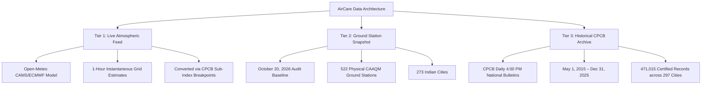

# AirCare — Air Quality Analysis and Visualization Platform
> **BCA Minor Project** | *Air Quality Analysis and Visualization Using Data Analytics*  
> **Technologies**: React 19, TypeScript, Vite, Tailwind CSS, Python (Pandas/NumPy), Open-Meteo API  
> **Version**: v1.1.0 (Production Overhaul & Enhanced Analytics)  

---

## 🌬️ 1. Project Overview

**AirCare** is an environmental data analytics and monitoring platform designed to transform complex, multi-year national air quality observations into clear, intuitive, and accessible insights for citizens, researchers, and public health advocates.

While official government portals often present air quality metrics in dense technical bulletins or fragmented tables, AirCare provides a unified, transparent, and aesthetically refined interface covering:
1. **Real-time atmospheric air quality estimates** derived from high-resolution satellite and atmospheric dispersion models.
2. **Over a decade of authentic ground-monitoring records (2015–2025)** sourced directly from the Central Pollution Control Board (CPCB), Ministry of Environment, Forest and Climate Change (MoEFCC), Government of India.
3. **Multi-city side-by-side comparative analytics** with meteorological and geographical contextualization.

---

## 🎯 2. Core Features & Capabilities

### Feature 1: Today's AQI (Live Atmospheric Estimates & Ground Snapshot)
- **Model-Estimated CPCB AQI**: Real-time atmospheric dispersion model feed (Open-Meteo CAMS / ECMWF reanalysis) converted into standard Indian CPCB AQI (0–500 scale) using official mathematical piecewise linear interpolation.
- **Criteria Pollutant Breakdown**: Instantaneous mass concentrations for 6 criteria pollutants: $\text{PM}_{2.5}$, $\text{PM}_{10}$, $\text{NO}_2$, $\text{SO}_2$, $\text{CO}$ (converted from $\mu\text{g}/\text{m}^3$ to $\text{mg}/\text{m}^3$), and $\text{O}_3$.
- **Methodology & Averaging Disclosure**: Explicitly discloses that live model values represent 1-hour instantaneous estimates rather than official 24-hour diurnal ground averages. Enforces CPCB minimum criteria ($\ge 3$ criteria pollutants with at least one particulate).
- **Physical Monitoring Station Snapshot**: An immutable audit snapshot of **522 continuous ambient air quality monitoring (CAAQM) stations across 273 Indian cities** recorded on October 20, 2026.

### Feature 2: Past Air Quality Explorer (10-Year Historical Archive)
- **Authentic CPCB Daily 4:00 PM Bulletins**: Complete 10-year archive covering **May 1, 2015 to December 31, 2025** across 297 Indian cities (471,015 daily records).
- **Flexible Lookup Modes**:
  - *Seasonal Presets*: November 2024 (Winter Peak), Diwali Festive Week (2024), Monsoon Baseline (July–August 2024), Winter Inversion (2023–24), and Historical Smog (2016).
  - *Date Range Mode*: Custom start and end dates with computed period average AQI, peak daily spike, cleanest recorded day, and data completeness percentage.
  - *Single Day Lookup*: Specific date query displaying exact recorded AQI, official bulletin category, dominant pollutant, active monitoring stations, and audit flags.
- **Data Integrity Guarantee**: Zero synthetic imputation. Missing records (due to station maintenance, power loss, or pre-commissioning dates) are preserved as `Data Unavailable` and never filled with zeros.

### Feature 3: Compare Cities (Cross-Geographic Analytics)
- **Side-by-Side Evaluation**: Compare 2 or 3 Indian cities across identical historical date windows.
- **Comparative Metrics**: Mean AQI, cleanest day, peak spike, severe pollution days ($\text{AQI} > 400$), and record completeness.
- **Geographic & Meteorological Factors**: Contextual explanations for disparities (e.g., landlocked Indo-Gangetic Plain thermal inversions vs. coastal ventilation in peninsular India vs. Deccan plateau elevation).

---

## 🏛️ 3. The Three Data Tiers (Strict Separation)

To maintain scientific integrity and comply with academic standards, AirCare strictly categorizes and visually differentiates data into three distinct tiers:



1. **Tier 1 (Live Atmospheric Model Feed)**: Hourly estimates produced by atmospheric dispersion and satellite assimilation models. Labeled clearly as **Model-Estimated CPCB AQI**.
2. **Tier 2 (Physical Monitoring Station Snapshot)**: A frozen point-in-time ground truth audit from 522 CAAQM sensors recorded on October 20, 2026.
3. **Tier 3 (Historical CPCB Bulletins)**: Official 24-hour diurnal averages published daily at 4:00 PM by the Central Pollution Control Board.

---

## 💻 4. System Prerequisites & Dependencies

### Prerequisites
- **Node.js**: Version 18.0.0 or higher (v20+ recommended)
- **npm**: Version 9.0.0 or higher
- **Python**: Version 3.10 or higher (for data processing pipeline and test suites)
- **Modern Web Browser**: Google Chrome, Microsoft Edge, Mozilla Firefox, or Safari with ECMAScript 2022 support

### Technology Stack
- **Frontend Framework**: React 19 (`react` & `react-dom` 19.3)
- **Language**: TypeScript (`~6.0.3`)
- **Build Tool**: Vite (`^8.3.4`)
- **Styling**: Tailwind CSS (`^3.4.19`), PostCSS, Autoprefixer
- **Icons**: Lucide React (`^1.60.0`), Material Symbols Outlined
- **Linting & Code Quality**: Oxlint (`^1.89.0`)
- **Data Analytics (ETL Pipeline)**: Python (Pandas, NumPy)
- **External API**: Open-Meteo Air Quality API (open-access, zero API keys required)

---

## 🚀 5. Local Setup & Execution Guide

Follow these exact commands to run the application locally:

### Step 1: Clone or Navigate to the Workspace
```bash
cd "E:\minor project"
```

### Step 2: Install Frontend Dependencies
```bash
cd frontend
npm install
```

### Step 3: Run the Development Server
```bash
npm run dev
```
Open your browser and visit:
```text
http://localhost:5173/
```

### Step 4: Run Production Build (TypeScript Validation & Bundling)
```bash
npm run build
```
The compiled, minified production assets will be generated in `frontend/dist/`.

### Step 5: Preview the Production Build Locally
```bash
npm run preview
```

---

## 🧪 6. Automated Testing & Verification

AirCare includes standalone automated verification test suites covering mathematical calculations, dataset integrity, and analytical queries:

```bash
# 1. Run TypeScript type-check and Vite production build
cd "E:\minor project\frontend"
npm run build

# 2. Run AST code linter
npm run lint

# 3. Run CPCB mathematical formula unit tests (CO conversion, O3, 3-pollutant criteria)
python "E:\minor project\tests\test_cpcb_formulas.py"

# 4. Run historical dataset query and aggregation verification
python "E:\minor project\tests\test_historical_analytics.py"

# 5. Run comprehensive runtime verification (live Open-Meteo queries & security scan)
python "E:\minor project\tests\test_runtime_comprehensive.py"

# 6. Run end-to-end headless browser verification (Chrome CDP)
node "E:\minor project\tests\test_browser_runtime.js"
```

---

## 📂 7. Project Documentation Directory

The project documentation is organized cleanly across dedicated directories:

### Academic & Technical Documentation (`docs/`)
* [PROJECT_REPORT.md](docs/PROJECT_REPORT.md): Comprehensive academic project report for the BCA Minor Project.
* [DATA_SOURCES_AND_METHODOLOGY.md](docs/DATA_SOURCES_AND_METHODOLOGY.md): In-depth guide to datasets, date coverage, CPCB sub-index formulas, and NAQI math.
* [DATASET_AUDIT_REPORT.md](docs/DATASET_AUDIT_REPORT.md): Comprehensive initial audit of raw datasets, schema validation, and missingness profiles.
* [DATA_CLEANING_REPORT.md](docs/DATA_CLEANING_REPORT.md): Detailed ETL pipeline audit, outlier capping policies, and category boundary shifts.
* [TESTING_REPORT.md](docs/TESTING_REPORT.md): Full testing matrix, execution outputs, and quality assurance logs.
* [FINAL_RUNTIME_VERIFICATION.md](docs/FINAL_RUNTIME_VERIFICATION.md): Verification results from live network queries and headless Chrome CDP automation.
* [VIVA_PREPARATION.md](docs/VIVA_PREPARATION.md): Comprehensive BCA viva voce preparation guide with 20 core questions and answers.
* [RELEASE_NOTES.md](docs/RELEASE_NOTES.md): Official v1.0.0 release notes, changelog, and architecture highlights.

### Historical Development Reports (`archive/development_reports/`)
* [cleanup_report.md](archive/development_reports/cleanup_report.md): Audit report of the chatbot removal and directory reorganization.
* [phase_4_completion_report.md](archive/development_reports/phase_4_completion_report.md): Verification report on live API integration and CPCB sub-index algorithms.
* [phase_5_completion_report.md](archive/development_reports/phase_5_completion_report.md): Verification report on historical data queries and boundary handling.

---

## 📂 8. Repository Structure

```text
E:\minor project\
├── README.md                           <- Master project documentation (this file)
├── .gitignore                          <- Root Git ignore configuration
│
├── 3b01bcb8-0b14-4abf-b6f2-*.csv       <- [RAW] CAAQM continuous monitoring stations snapshot (Oct 20, 2026)
├── city_day.csv                        <- [RAW] Kaggle multi-pollutant city daily dataset (2015-2020)
├── cpcb_city_aqi_2015_2025.csv         <- [RAW] CPCB official 4pm daily bulletin archive (2015-2025)
│
├── processed_data/                     <- Verified, cleaned & normalized datasets
│   ├── cleaned_cpcb_aqi_bulletins.csv  <- 471,015 daily bulletin records
│   ├── cleaned_city_day.csv            <- 29,531 multi-pollutant records
│   └── cleaned_live_station_snapshot.csv <- 522 physical ground stations
│
├── scripts/                            <- Data processing & partitioning scripts
│   ├── clean_data.py                   <- Python cleaning pipeline for raw CSVs
│   └── prepare_frontend_data.py        <- City-partitioning script for lightweight JSON delivery
│
├── tests/                              <- Standalone automated test suites
│   ├── test_cpcb_formulas.py           <- CPCB NAQI formula & breakpoint unit tests
│   ├── test_historical_analytics.py    <- CPCB bulletin query and statistics verification
│   ├── test_runtime_comprehensive.py   <- Comprehensive live API & security verification
│   └── test_browser_runtime.js         <- Headless Chrome CDP end-to-end browser tests
│
├── docs/                               <- Academic documentation & viva preparation
│   ├── PROJECT_REPORT.md               <- Comprehensive BCA academic project report
│   ├── DATA_SOURCES_AND_METHODOLOGY.md <- Deep-dive into datasets, cleaning, and NAQI math
│   ├── DATASET_AUDIT_REPORT.md         <- Initial exploratory dataset audit
│   ├── DATA_CLEANING_REPORT.md         <- Detailed data cleaning pipeline report
│   ├── TESTING_REPORT.md               <- Test execution logs and assertions
│   ├── FINAL_RUNTIME_VERIFICATION.md   <- Live runtime and CDP browser test evidence
│   ├── VIVA_PREPARATION.md             <- BCA viva voce guide with 20+ Q&As
│   └── RELEASE_NOTES.md                <- Release notes for v1.0.0
│
├── archive/                            <- Historical archival files
│   └── development_reports/            <- Milestone & phase completion reports
│       ├── cleanup_report.md           <- Chatbot removal & codebase cleanup report
│       ├── phase_4_completion_report.md
│       └── phase_5_completion_report.md
│
├── stitch_exports/                     <- Historical Stitch UI mockups & component designs
│
└── frontend/                           <- Pure Client-Side React 19 + TypeScript SPA
    ├── package.json                    <- Dependencies (React 19, Lucide, Tailwind, Vite)
    ├── vite.config.ts                  <- Vite configuration
    ├── tailwind.config.js              <- Tailwind theme & color tokens
    ├── postcss.config.js               <- PostCSS configuration
    ├── .env.example                    <- Optional public WAQI token notice
    ├── public/
    │   ├── favicon.svg                 <- Application favicon
    │   └── data/                       <- Partitioned JSON datasets served to browser
    │       ├── bulletins_index.json    <- Metadata index for 297 Indian cities
    │       ├── bulletins/              <- Per-city bulletin records (e.g. delhi.json)
    │       ├── city_day/               <- Per-city multi-pollutant records
    │       └── station_snapshot.json   <- Frozen 522 CAAQM station snapshot
    └── src/
        ├── App.tsx                     <- Application router managing 3 core features
        ├── main.tsx                    <- React entry point
        ├── index.css                   <- Global Tailwind styles
        ├── types/
        │   └── index.ts                <- Shared TypeScript interface definitions
        ├── pages/
        │   ├── TodaysAqi.tsx           <- Live atmospheric model feed & station snapshot
        │   ├── PastAqi.tsx             <- 10-year historical CPCB archive & preset explorer
        │   └── CompareCities.tsx       <- Multi-city side-by-side comparative analytics
        ├── services/
        │   ├── liveAqiService.ts       <- Open-Meteo client & CPCB sub-index calculation
        │   └── airQualityData.ts       <- Historical JSON data fetcher & aggregators
        └── components/
            ├── Header.tsx              <- Navigation header for 3 features
            └── Footer.tsx              <- Standard disclosures and data notices
```

---

## 📜 9. Data Attribution & Academic Ethics

1. **Central Pollution Control Board (CPCB)**, Ministry of Environment, Forest and Climate Change, Government of India: Official daily national ambient air quality bulletins and CAAQM station observations.
2. **Open-Meteo**: High-Resolution Atmospheric Air Quality API based on the Copernicus Atmosphere Monitoring Service (CAMS) and ECMWF atmospheric dispersion models.
3. **Open Government Data (OGD) Platform India (`data.gov.in`)**: Published environmental open data datasets.

*This project is submitted in partial fulfillment of the requirements for the Bachelor of Computer Applications (BCA) degree. All environmental data analysis is intended for academic research, educational demonstration, and citizen awareness.*

---

## 📚 10. Advanced Architectural Proposals & Reports

- **FastAPI Backend Proposal**: [`docs/BACKEND_ARCHITECTURE_PROPOSAL.md`](docs/BACKEND_ARCHITECTURE_PROPOSAL.md)
- **Machine Learning Roadmap (v2.0)**: [`docs/MACHINE_LEARNING_PROPOSAL.md`](docs/MACHINE_LEARNING_PROPOSAL.md)
- **Comprehensive Project Report**: [`docs/PROJECT_REPORT.md`](docs/PROJECT_REPORT.md)
- **Data Methodology & Sources**: [`docs/DATA_SOURCES_AND_METHODOLOGY.md`](docs/DATA_SOURCES_AND_METHODOLOGY.md)
- **Testing & Multi-Viewport Verification**: [`docs/TESTING_REPORT.md`](docs/TESTING_REPORT.md)
