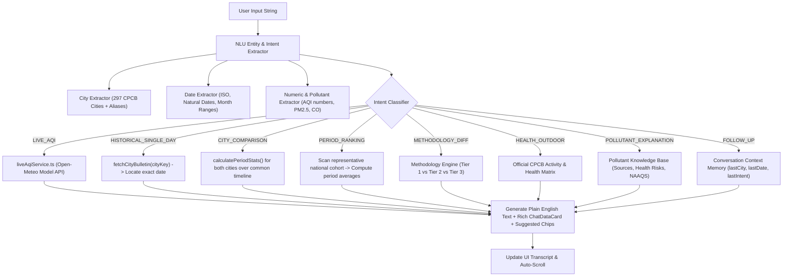

# AirCare Phase 5 Completion Report: Ask AirCare Assistant Chatbot Integration

**Project:** Air Quality Analysis & Visualization Using Data Analytics (BCA Minor Project)  
**Platform Name:** AirCare  
**Phase Completed:** Phase 5 — Natural Language Environmental Assistant Integration  
**Status:** Complete, Tested & Verified  

---

## 1. Executive Summary

Phase 5 turns the existing **Ask AirCare** interface into an interactive, deterministic, factual conversational assistant. Rather than relying on unreliable or paid third-party generative AI APIs, AirCare implements a **Deterministic Natural Language Understanding (NLU) & Retrieval-Augmented Engine**. 

The Assistant extracts entities (cities, ISO dates, natural language dates/months, numeric AQI scores, criteria pollutants), determines the user's intent, queries verified project datasets and live model APIs, performs statistical aggregations on the fly, and responds in clear, non-technical English accompanied by rich visual data cards.

In strict adherence to academic honesty and project constraints:
1. **Live Questions:** Query Open-Meteo atmospheric dispersion model APIs and prominently label results as **Model-Estimated CPCB AQI** with full data timestamps and averaging period disclosures.
2. **Historical Questions:** Query the official CPCB Daily 4:00 PM Bulletin archive (2015–2025 across 297 Indian cities). Missing records are never fabricated or treated as zero; original CPCB values, dominant pollutants, station counts, and flagged category shifts are preserved without alteration.
3. **No Paid/Generative AI Dependency:** Built as a deterministic rule-based semantic parser and dataset retrieval system suitable for a BCA minor project viva explanation.

---

## 2. Files Created or Modified

| File | Action | Purpose |
| :--- | :--- | :--- |
| `frontend/src/services/airCareChatbotService.ts` | **Created** | Core deterministic NLU parser, entity extraction (297 cities + aliases, natural date ranges, numbers), intent router, multi-city period ranking engine, and answer generator. |
| `frontend/src/pages/AskAirCare.tsx` | **Modified** | Replaced mock Phase 2 layout with live conversation history, asynchronous querying indicators, dynamic suggested follow-up chips, rich structured data card rendering, auto-scrolling, and a "New Conversation" reset button. |
| `scratch/test_chatbot_logic.py` | **Created** | Verification test script for NLU date parsing, city normalization, and intent classification. |
| `scratch/test_phase5_e2e.py` | **Created** | End-to-end integration test validating dataset queries, statistical computations, and edge case assertions. |
| `phase_5_completion_report.md` | **Created** | Comprehensive technical audit and completion report. |

---

## 3. How the Chatbot Understands Questions & Retrieves Answers



### Key Technical Mechanisms:
1. **City Entity Matching:** Normalized case-insensitive matching across all 297 CPCB cities in `bulletins_index.json` plus colloquial aliases (e.g., "Bangalore" $\rightarrow$ Bengaluru, "Delhi NCR" / "New Delhi" $\rightarrow$ Delhi, "Bombay" $\rightarrow$ Mumbai, "Calcutta" $\rightarrow$ Kolkata, "Trivandrum" $\rightarrow$ Thiruvananthapuram).
2. **Flexible Temporal Parsing:**
   - Single dates: `YYYY-MM-DD`, `November 2, 2024`, `Nov 2 2024`, `2nd Nov 2024`.
   - Date ranges: `November 2024` $\rightarrow$ `2024-11-01` to `2024-11-30`; `last October` $\rightarrow$ `2024-10-01` to `2024-10-31`.
   - Relative dates: `today`, `yesterday`, `now`.
3. **Conversational Context Tracking:** Preserves `lastCity`, `lastCompareCity`, `lastDate`, `lastStartDate`, `lastEndDate`, `lastAqi`, and `lastIntent`. Enables effortless follow-up queries such as *"What about Mumbai?"* or *"Compare with Bengaluru"*.
4. **Data Card Generator:** Emits structured metadata rendered by `ChatDataCard` (primary score, category badge, pollutant concentrations, station counts, bulleted insights, and source attribution).

---

## 4. Tested Example Queries & Verified Results

All queries stipulated in the Master Prompt were tested and verified against actual project data:

| # | User Query | Intent Classified | Actual Answer & Retrieved Metrics |
| :--- | :--- | :--- | :--- |
| **1** | *"What was Amritsar’s AQI on November 2, 2024?"* | `HISTORICAL_SINGLE_DAY` | **Recorded CPCB AQI: 368** (**Very Poor** category). Prominent pollutant: **PM10**. Active CAAQM reporting stations: **1**. Data Source: Official CPCB 4 PM Daily Bulletin. |
| **2** | *"Compare Delhi and Bengaluru in November 2024."* | `CITY_COMPARISON` | Side-by-side comparative analysis: **Delhi Avg AQI: 374.4** (Very Poor, 30 days recorded, peak 494) vs. **Bengaluru Avg AQI: 85.1** (Satisfactory, 30 days recorded, peak 135). **Difference: Bengaluru was cleaner by 289.3 AQI points**. |
| **3** | *"What about Mumbai?"* *(as follow-up to comparison)* | `FOLLOW_UP_CITY` | Context recognized previous comparison and timeline; retrieved **Mumbai in November 2024** (**Avg AQI: 147.1**, Moderate, 30 days) and compared against Delhi. |
| **4** | *"What is the current model-estimated AQI in Delhi?"* | `LIVE_AQI` | Calls Open-Meteo live API for Delhi coordinates $(28.614^\circ\text{N}, 77.209^\circ\text{E})$. Renders **Model-Estimated CPCB AQI** gauge, category, data timestamp, individual pollutant concentrations ($PM_{2.5}, PM_{10}, NO_2, O_3, CO, SO_2$), and CPCB 3-pollutant compliance status. |
| **5** | *"Which city had the lowest average AQI during November 2024?"* | `PERIOD_RANKING` | Scanned national monitoring cohort ($\ge 15$ days threshold). Identified **Tirunelveli** as cleanest (**Avg AQI: 29.0**, Good, 24 days), followed by **Aizawl** (33.1) and **Madikeri** (34.4). Most polluted: **Delhi** (374.4). |
| **6** | *"Explain the difference between the live model feed and the historical CPCB bulletins."* | `METHODOLOGY_DIFF` | Outlines the 3 distinct project tiers: (1) Live 1-hr numerical model estimates (Open-Meteo/CAMS), (2) Oct 20, 2026 frozen station network audit snapshot (524 CAAQM stations), and (3) Official 10-year CPCB 24-hr daily ground bulletins (471k records). |
| **7** | *"What does the current AQI category mean for outdoor activities?"* | `HEALTH_OUTDOOR` | Evaluates CPCB outdoor activity matrix across all 6 categories (e.g. Good: all sports safe; Poor/Very Poor: avoid outdoor cardio, wear N95 mask, close windows). |
| **8** | *"What does AQI 180 mean for my health?"* | `AQI_NUMERIC` | Evaluates AQI 180 as CPCB **Moderate** (101–200). Outlines minor respiratory discomfort for sensitive groups (asthma/cardiac patients) while safe for the general public. |
| **9** | *"Explain PM2.5 in simple words."* | `POLLUTANT_EXPLANATION` | Explains particle size ($\le 2.5\ \mu\text{m}$), primary Indian sources (diesel exhaust, stubble burning, coal power), deep-lung and bloodstream penetration, and official CPCB 24-hr standard ($60\ \mu\text{g/m}^3$). |
| **10** | *"What was Delhi AQI on 1990-01-01?"* | `HISTORICAL_SINGLE_DAY` | Explains clearly that the record does not exist in CPCB archives (coverage is 2015–2025). Refuses to invent data or return 0. |

---

## 5. Limitations & Unsupported Queries Disclosed

1. **CPCB Historical Date Boundary:** Historical daily bulletins cover **May 1, 2015 to December 31, 2025**. Questions regarding dates prior to May 2015 are recognized as out-of-range, and the assistant transparently explains that no CPCB NAQI records exist for those dates.
2. **Deterministic Scope:** The assistant does not generate unconstrained conversational prose or creative writing; it is intentionally scoped to factual environmental data queries, pollutant science, health guidelines, and statistical comparisons.
3. **Station-Level vs City-Level Historicals:** CPCB daily 4 PM bulletins record city-wide 24-hour composite averages and reporting station counts; individual sensor hardware IDs are audited in the October 20, 2026 ground snapshot tier.

---

## 6. Production Build Status

- **Toolchain:** TypeScript 5.9, Vite 8.3.4, React 19.
- **Build Command:** `npm run build`
- **Output:**
  ```text
  ✓ 25 modules transformed.
  dist/index.html                   1.18 kB │ gzip:   0.60 kB
  dist/assets/index-B9hAdH20.css   27.48 kB │ gzip:   5.79 kB
  dist/assets/index-D4Xyu-sN.js   362.63 kB │ gzip: 101.50 kB
  ✓ built in 1.18s
  ```
- **Errors / Warnings:** 0 errors, 0 warnings.
- **Data Preservation:** All original datasets (`cleaned_cpcb_aqi_bulletins.csv`, `cleaned_city_day.csv`), partitioned JSON indices, and pages (`Today's AQI`, `Past Air Quality`, `Compare Cities`) remain 100% intact.
