# AirCare: Data Sources, Cleaning Pipeline & Calculation Methodology
> **BCA Minor Project Technical Documentation**
> **Topic**: Air Quality Analysis and Visualization Using Data Analytics
> **Document Version**: 1.0.0 (Release Candidate)

---

## 📑 Table of Contents
1. [Overview & Scientific Integrity](#1-overview--scientific-integrity)
2. [Data Sources & Architecture (The Three Tiers)](#2-data-sources--architecture-the-three-tiers)
3. [Raw Dataset Audits & Metadata](#3-raw-dataset-audits--metadata)
4. [Data Cleaning Pipeline (`clean_data.py`)](#4-data-cleaning-pipeline-cleandatapy)
5. [Frontend Partitioning Architecture (`prepare_frontend_data.py`)](#5-frontend-partitioning-architecture-preparefrontenddatapy)
6. [CPCB National Air Quality Index (NAQI) Calculation](#6-cpcb-national-air-quality-index-naqi-calculation)
7. [Unit Conversions & Mathematical Edge Cases](#7-unit-conversions--mathematical-edge-cases)
8. [Scientific Caveats & Limitations](#8-scientific-caveats--limitations)
9. [Archived Atmospheric & Meteorological Backfill (Tier 4)](#9-archived-atmospheric--meteorological-backfill-tier-4)
10. [Database Schema & Provenance Architecture](#10-database-schema--provenance-architecture)

---

## 🔬 1. Overview & Scientific Integrity

A primary objective of the **AirCare** platform is to present environmental data with absolute mathematical and scientific rigor. In many public environmental dashboards, missing values are silently imputed as zero, disparate averaging periods are conflated, and mathematical sub-indices are calculated without validating pollutant criteria.

AirCare adheres to the following principles:
- **No Data Fabrication**: If an observation was not recorded on a specific day, the system explicitly reports `Data Unavailable`. Missing AQI values are **never** treated as zero (which would falsely indicate pristine air).
- **Strict Separation of Data Tiers**: Atmospheric dispersion model predictions, static station audits, and certified historical CPCB bulletins are clearly demarcated in the UI, API services, and database layers.
- **Official CPCB Mathematical Standards**: Sub-index calculations strictly enforce the breakpoints, piecewise linear interpolation, and minimum pollutant rules mandated by the Central Pollution Control Board (CPCB), Ministry of Environment, Forest and Climate Change (MoEFCC), Government of India.

---

## 🏛️ 2. Data Sources & Architecture (The Four Tiers)

To prevent misinterpretation, AirCare organizes all data flows into four distinct tiers:

| Tier | Source / Provider | Data Type | Temporal Coverage | Measurement Mode | Purpose in AirCare |
| :--- | :--- | :--- | :--- | :--- | :--- |
| **Tier 1: Live Feed** | Open-Meteo Air Quality API (CAMS Global) | Atmospheric Model Assimilation & Forecast | Instantaneous (Current hour, updated 3-hourly) | Numerical weather & chemical dispersion grid (~45 km resolution) | Provides immediate, real-time air quality estimates for tracked Indian cities. |
| **Tier 2: Station Snapshot** | OGD Platform / CPCB CAAQMS Network | Physical Ground Station Sensors | Frozen point-in-time: **October 20, 2026, 10:00 AM IST** | Static audit of 524 physical continuous monitoring stations | Demonstrates physical sensor network density and real-time ground-station telemetry. |
| **Tier 3: Historical Archive** | CPCB Daily 4:00 PM National Air Quality Bulletins | Certified Regulatory Ground Averages | **May 1, 2015 to December 31, 2025** (10+ years) | 24-hour diurnal averages from certified CAAQMS stations | Core analytical archive powering 10-year trend analyses, seasonal comparisons, and city rankings. |
| **Tier 4: Atmospheric Backfill** | Open-Meteo Air Quality & Weather APIs (CAMS + ECMWF IFS) | Archived Atmospheric & Numerical Weather Forecasts | Previous 90 Days (Trailing continuous window) | Native 3-hour timesteps (00, 03, 06, 09, 12, 15, 18, 21 UTC) | Machine learning training baseline, high-resolution temporal diurnal analysis, and boundary layer dispersion modeling. |

```mermaid
flowchart TD
    subgraph Tier 1: Live Atmospheric Feed
        OM[Open-Meteo API] -->|Hourly CAMS Model| L1[Instantaneous Concentrations]
        L1 --> L2[CPCB Sub-Index Calculator]
        L2 --> L3["Model-Estimated CPCB AQI (TodaysAqi.tsx)"]
    end

    subgraph Tier 2: Station Snapshot
        SS[OGD / CPCB CSV Snapshot] -->|524 Physical Stations| S1[station_snapshot.json]
        S1 --> S2["Frozen Audit Network (Oct 20, 2026)"]
    end

    subgraph Tier 3: Historical Archive
        CPCB[CPCB 4 PM Bulletins CSV] -->|471,015 Records| C1[clean_data.py Pipeline]
        KAGGLE[Kaggle City_Day CSV] -->|29,531 Multi-Pollutant Records| C1
        C1 --> C2[prepare_frontend_data.py]
        C2 --> C3[Partitioned City JSON Chunks]
        C3 --> C4["PastAqi.tsx & CompareCities.tsx"]
    end
```

---

## 📊 3. Raw Dataset Audits & Metadata

The project repository preserves the original, unedited source datasets:

### 1. `cpcb_city_aqi_2015_2025.csv` (Primary Historical Archive)
- **Origin**: Central Pollution Control Board (CPCB), Government of India.
- **File Size**: 19.2 MB (471,015 rows, 6 columns).
- **Date Range**: May 1, 2015 to December 31, 2025 (3,898 continuous calendar days).
- **Geographic Coverage**: 297 Indian cities across 28 states and union territories.
- **Fields**:
  - `City`: Name of the Indian city (e.g., *Delhi*, *Amritsar*, *Bengaluru*).
  - `Date`: Date of the 4:00 PM bulletin (`YYYY-MM-DD`).
  - `AQI`: Reported 24-hour average National AQI (numeric integer, range: 0–500).
  - `AQI_Bucket`: Official qualitative category (*Good*, *Satisfactory*, *Moderate*, *Poor*, *Very Poor*, *Severe*).
  - `Prominent_Pollutant`: Primary driving pollutant determined by maximum sub-index (e.g., $PM_{2.5}$, $PM_{10}$, $NO_2$).
  - `Active_Stations`: Number of physical monitoring stations reporting data in that city for that bulletin.

### 2. `city_day.csv` (Secondary Multi-Pollutant Archive)
- **Origin**: CPCB continuous stations compiled on Kaggle (2015–2020).
- **File Size**: 2.57 MB (29,531 rows, 16 columns).
- **Date Range**: January 1, 2015 to July 1, 2020.
- **Fields**: Individual daily pollutant concentrations for $PM_{2.5}$, $PM_{10}$, $NO$, $NO_2$, $NO_x$, $NH_3$, $CO$, $SO_2$, $O_3$, $Benzene$, $Toluene$, and $Xylene$, alongside calculated AQI and Bucket.

### 3. `3b01bcb8-0b14-4abf-b6f2-c1bfd384ba69.csv` (Live Ground Station Snapshot)
- **Origin**: Open Government Data (OGD) Platform India (`data.gov.in`) / CPCB Real-time CAAQMS.
- **File Size**: 415 KB (1,159 station-pollutant rows).
- **Capture Timestamp**: October 20, 2026, 10:00 AM IST.
- **Coverage**: 524 continuous monitoring stations across 273 cities.

---

## 🧹 4. Data Cleaning Pipeline (`clean_data.py`)

The automated Python pipeline `clean_data.py` executes rigorous data quality, validation, and normalization steps while strictly preserving raw files.

### 1. Handling Missing Data & Sparse Coverage
- **Policy**: Real-world environmental monitoring experiences gaps due to sensor recalibration, power outages, and communication interruptions. Furthermore, CPCB's monitoring network grew substantially over the 10-year span (from 12 cities in 2015 to 297 cities in 2025).
- **Rule**: Rows with missing AQI values are **never filled with zeros or statistical means**. Imputing zero would indicate perfect air quality; imputing the mean would mask seasonal spikes like Diwali or winter smog. Missing dates are preserved as absent rows, allowing the frontend to report exact completeness percentages (e.g., $9/9\ \text{days} = 100\%$, or $24/30\ \text{days} = 80\%$).

### 2. Anomaly & Outlier Resolution
- **Physical Feasibility Bounds**: CPCB NAQI is defined on a mathematical scale from 0 to 500.
  - Values $< 0$ or $> 500$ were flagged as sensor transmission errors or non-standard experimental reporting.
  - Extreme values between 450 and 500 (frequent in northern Indian winters) were evaluated against neighboring dates and confirmed as genuine severe atmospheric events rather than statistical outliers.

### 3. Category Inconsistency Auditing & Preservation
In the raw CPCB bulletin dataset, an anomaly occurs on certain historical records:
- *Example*: Delhi on `2018-02-24` recorded an AQI of **300**, but the official bulletin labelled it as `Very Poor` instead of `Poor` (as $201 \le AQI \le 300$ is mathematically `Poor` under CPCB rules).
- *Resolution*: Rather than modifying official regulatory records, AirCare stores the official recorded bucket as ground truth while adding a boolean flag `Category_Inconsistent: True`. The user interface displays an informational notice explaining that the bulletin reflects an official historical override or boundary edge condition.

---

## ⚡ 5. Frontend Partitioning Architecture (`prepare_frontend_data.py`)

A critical challenge in building a client-side web application with 471,015 records is browser memory consumption and initial load latency. Shipping a single 27 MB CSV file would cause excessive mobile load times and browser tab crashes.

### The City-Partitioning Solution:
1. `prepare_frontend_data.py` reads the cleaned CPCB bulletin archive and generates a lightweight metadata index file:
   - `frontend/public/data/bulletins_index.json` (~46 KB): Contains city keys, display names, state, total recorded days, start date, and end date for all 297 cities.
2. The dataset is partitioned into individual per-city JSON files:
   - `frontend/public/data/bulletins/{city_key}.json` (e.g., `delhi.json`, `mumbai.json`, `amritsar.json`).
3. **On-Demand Lazy Loading**: When a user selects a city in *Past Air Quality* or *Compare Cities*, the application fetches only that specific city's JSON file (~10 KB to ~80 KB compressed). This reduces network payload by **99.7%** and ensures sub-50ms query speeds.

---

## 📐 6. CPCB National Air Quality Index (NAQI) Calculation

The National Air Quality Index is calculated using the official CPCB piecewise linear interpolation methodology published in the MoEFCC/CPCB NAQI Technical Report.

### Mathematical Sub-Index Formula
For any given pollutant concentration $C_p$, the sub-index $I_p$ is calculated as:

$$I_p = I_{lo} + \frac{(I_{hi} - I_{lo})}{(B_{hi} - B_{lo})} \times (C_p - B_{lo})$$

Where:
- $C_p$ = Observed concentration of pollutant $p$
- $B_{hi}$ = Breakpoint concentration greater than or equal to $C_p$
- $B_{lo}$ = Breakpoint concentration less than or equal to $C_p$
- $I_{hi}$ = AQI sub-index value corresponding to $B_{hi}$
- $I_{lo}$ = AQI sub-index value corresponding to $B_{lo}$

### Official CPCB Breakpoint Table (6 Pollutants)

| AQI Category | Sub-Index Range ($I_{lo} - I_{hi}$) | $PM_{2.5}$ ($\mu g/m^3$, 24-hr) | $PM_{10}$ ($\mu g/m^3$, 24-hr) | $NO_2$ ($\mu g/m^3$, 24-hr) | $SO_2$ ($\mu g/m^3$, 24-hr) | $CO$ ($mg/m^3$, 8-hr) | $O_3$ ($\mu g/m^3$, 8-hr) |
| :--- | :--- | :--- | :--- | :--- | :--- | :--- | :--- |
| **Good** | 0 – 50 | 0 – 30 | 0 – 50 | 0 – 40 | 0 – 40 | 0.0 – 1.0 | 0 – 50 |
| **Satisfactory** | 51 – 100 | 31 – 60 | 51 – 100 | 41 – 80 | 41 – 80 | 1.1 – 2.0 | 51 – 100 |
| **Moderate** | 101 – 200 | 61 – 90 | 101 – 250 | 81 – 180 | 81 – 380 | 2.1 – 10.0 | 101 – 168 |
| **Poor** | 201 – 300 | 91 – 120 | 251 – 350 | 181 – 280 | 381 – 800 | 10.1 – 17.0 | 169 – 208 |
| **Very Poor** | 301 – 400 | 121 – 250 | 351 – 430 | 281 – 400 | 801 – 1600 | 17.1 – 34.0 | 209 – 748 |
| **Severe** | 401 – 500 | 250+ | 430+ | 400+ | 1600+ | 34.0+ | 748+ |

---

## ⚙️ 7. Unit Conversions & Mathematical Edge Cases

### 1. Carbon Monoxide ($CO$) Unit Conversion
- **The Caveat**: Most online atmospheric models (including Open-Meteo) return Carbon Monoxide concentration in micrograms per cubic meter ($\mu g/m^3$). However, the official CPCB breakpoint table is defined in milligrams per cubic meter ($mg/m^3$).
- **The Implementation**:
  $$C_{CO\ (mg/m^3)} = \frac{C_{CO\ (\mu g/m^3)}}{1000}$$
  Failing to divide by 1000 would cause a normal ambient $CO$ reading of $600\ \mu g/m^3$ to be evaluated as $600\ mg/m^3$, triggering a false `Severe` ($AQI = 500$) reading. AirCare converts all $CO$ inputs to $mg/m^3$ before applying piecewise linear interpolation.

### 2. CPCB Minimum Criteria Pollutant Rule
According to the CPCB NAQI guidelines:
1. An overall AQI can **only** be calculated if data is available for at least **three (3) criteria pollutants**.
2. Out of the available pollutants, **at least one must be a particulate matter fraction** ($PM_{2.5}$ or $PM_{10}$).
3. If fewer than 3 pollutants are available, or if neither particulate fraction is monitored, the calculation is aborted, and the UI displays `Insufficient Pollutants Monitored`.

### 3. Overall AQI & Dominant Pollutant Selection
The overall city AQI is governed by the maximum sub-index (worst pollutant):

$$AQI = \max(I_{PM2.5}, I_{PM10}, I_{NO2}, I_{SO2}, I_{CO}, I_{O3})$$

The pollutant generating this maximum sub-index is designated as the **Prominent Pollutant** (Dominant Pollutant).

---

## ⚠️ 8. Scientific Caveats & Limitations

To ensure transparency in academic examinations, the following limitations are explicitly noted:

1. **Averaging Period Discrepancy**:
   - Official CPCB NAQI bulletins are derived from **24-hour diurnal integrated averages** for $PM_{2.5}$, $PM_{10}$, $NO_2$, and $SO_2$, and **8-hour running averages** for $CO$ and $O_3$ from physical continuous stations.
   - The live feed from Open-Meteo represents **1-hour instantaneous model reanalysis**. While sub-index formulas are applied faithfully, instantaneous values fluctuate more rapidly than 24-hour diurnal averages. AirCare explicitly labels live scores as **Model-Estimated CPCB AQI** to reflect this distinction.
2. **Spatial Resolution**:
   - Atmospheric dispersion models operate on an $\sim 11\ \text{km} \times 11\ \text{km}$ spatial grid. Hyperlocal emissions (such as street-corner traffic idling or localized construction) may differ from regional model grid estimates.
3. **Temporal Boundary of Historical Records**:
   - The verified CPCB bulletin archive spans **May 1, 2015 to December 31, 2025**. Historical queries prior to May 1, 2015 cannot be answered because India's National AQI system was officially established in April 2015.

---

## 🌪️ 9. Archived Atmospheric & Meteorological Backfill (Tier 4)

To bridge the gap between decade-long daily historical bulletins (Tier 3) and real-time live updates (Tier 1), AirCare introduces **Tier 4: Archived Atmospheric Model & Meteorological Backfill**.

### 9.1 Data Provenance & Atmospheric Model Specifics
1. **Chemical Transport Dataset (Pollutants)**:
   - **Provider**: Open-Meteo Air Quality Service.
   - **Underlying Dataset**: Copernicus Atmosphere Monitoring Service (**CAMS Global Atmospheric Composition Forecasts**), operated by ECMWF (European Centre for Medium-Range Weather Forecasts) using the IFS-COMPO model cycle.
   - **Spatial Resolution**: Global grid of **$0.4^\circ \times 0.4^\circ$** (approximately $40\ \text{km} \times 45\ \text{km}$ over the Indian subcontinent).
   - **Native Temporal Resolution**: **3-hourly** output cycles ($00:00$, $03:00$, $06:00$, $09:00$, $12:00$, $15:00$, $18:00$, $21:00\ \text{UTC}$).
   - **Interpolation Status**: While API providers frequently offer 1-hour arrays via linear interpolation between model steps, AirCare explicitly samples the native 3-hourly timesteps. Intermediate interpolated hours are **never mischaracterized as independent physical observations**.
2. **Meteorological Dataset (Weather & Boundary Layer)**:
   - **Provider**: Open-Meteo Weather Forecast API.
   - **Underlying Model**: ECMWF Integrated Forecasting System (**IFS Numerical Weather Prediction**).
   - **Parameters Tracked**: Ambient 2m Temperature ($^\circ\text{C}$), 2m Relative Humidity ($\%$), 10m Wind Speed ($\text{m/s}$), and Planetary Boundary Layer Height ($\text{m}$).
   - **Temporal Availability**: Up to 62 past days are preserved on the operational forecast archive endpoint.
3. **Ventilation Coefficient ($V_c$)**:
   - Atmospheric dispersion capacity is quantified via the Ventilation Coefficient:
     $$V_c = \text{PBLH}\ (\text{m}) \times \text{Wind Speed}_{10\text{m}}\ (\text{m/s}) \quad [\text{m}^2/\text{s}]$$
   - $V_c < 2000\ \text{m}^2/\text{s}$ indicates poor atmospheric ventilation (nocturnal thermal inversions trapping surface pollutants, common in winter Delhi).
   - $V_c > 6000\ \text{m}^2/\text{s}$ indicates high atmospheric flushing capacity (strong daytime convective dispersion).
4. **Classification: Archived Forecast vs. Retrospective Reanalysis**:
   - The 90-day backfill originates from archived operational forecast runs.
   - In AirCare, this data is strictly classified as `source_type = 'archived_forecast'`.
   - It is distinguished from true multi-decadal retrospective climate reanalyses (such as ERA5 or CAMS EAC4), which assimilate historical observations retrospectively with a delayed quality-assurance window.

### 9.2 CPCB Completeness Rules vs. Model-Derived Rolling Estimates
- **The CPCB 16-Hour Completeness Mandate**: Official CPCB guidelines stipulate that a daily regulatory bulletin requires at least 16 valid hourly physical measurements ($16/24 \ge 66.7\%$). This rule was formulated strictly for physical Continuous Ambient Air Quality Monitoring Stations (CAAQMS) to guard against sensor calibration downtime and hardware dropouts.
- **Scientific Boundary**: Applying CPCB's 16-valid-hour station rule to 3-hourly or interpolated numerical model grids is scientifically inappropriate. Numerical model simulations represent continuous spatial integration, not discrete sensor uptime.
- **Model-Derived Rolling Estimates**: AirCare computes multi-hour rolling arithmetic means (24-hour retrospective windows for particulate matter and gaseous pollutants; 8-hour windows for $CO$ and $O_3$). These metrics are explicitly stored in structured columns labeled `rolling_24h_pm2_5`, `rolling_24h_pm10`, and `derived_rolling_aqi`, and are clearly documented as **model-derived estimates**, not regulatory ground-station averages.

---

## 🗄️ 10. Database Schema & Provenance Architecture

To enforce absolute data segregation, prevent data poisoning, and ensure high query performance, the Supabase schema implements the following structural protections:

### 10.1 Provenance Segregation & Unique Constraints
- **Table**: `air_quality_readings`
- **Unique Constraint**: `uq_city_source_observed UNIQUE (city, source, observed_at)`
  - Live automated collection runs write with `source = 'open-meteo'` and `source_type = 'atmospheric_model'`.
  - Historical backfill runs write with `source = 'open-meteo-historical'` and `source_type = 'archived_forecast'`.
  - Ground-station audits write with `source = 'cpcb-ogd-snapshot'` and `source_type = 'physical_station'`.
  - This compound key guarantees that backfill jobs can never overwrite live real-time records, even if timestamps overlap.

### 10.2 Structured Storage vs. JSON Trapping
Rather than burying analytical metrics inside unstructured JSON dictionaries, AirCare separates data into dedicated, typed SQL columns:
- **Raw Instantaneous Fields**: `pm2_5`, `pm10`, `no2`, `so2`, `co`, `o3` ($\mu\text{g/m}^3$, with $CO$ in $\text{mg/m}^3$).
- **Instantaneous AQI**: `estimated_aqi`, `aqi_category`, `dominant_pollutant`.
- **Structured Rolling Averages**: `rolling_24h_pm2_5`, `rolling_24h_pm10`, `rolling_24h_no2`, `rolling_24h_so2`, `rolling_8h_co`, `rolling_8h_o3`.
- **Derived Rolling AQI**: `derived_rolling_aqi`, `derived_rolling_category`.
- **Structured Meteorology**: `temperature_c`, `relative_humidity_pct`, `wind_speed_10m_ms`, `boundary_layer_height_m`, `ventilation_coefficient_m2s`.
- **Deep Provenance (JSONB)**: `model_or_source_metadata` preserves upstream provider headers, grid coordinates, downsampling flags, and sub-index calculation breakdowns.
