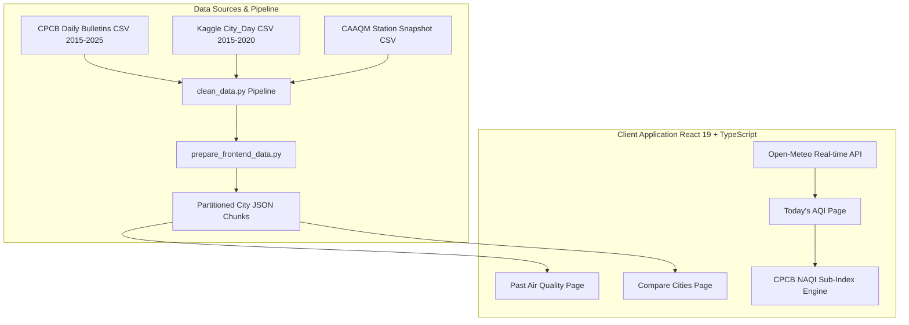

# AirCare: BCA Minor Project Viva Voce Preparation Guide
> **Degree**: Bachelor of Computer Applications (BCA)  
> **Project Title**: Air Quality Analysis and Visualization Using Data Analytics (**AirCare**)  
> **Domain**: Environmental Data Analytics, Frontend Engineering, Data Visualization  
> **Target Audience**: BCA Final Exam Students, Faculty Mentors, and External Viva Examiners  

---

## 🧭 How to Use This Guide
This document is designed to help you confidently answer questions during your **Minor Project Viva Voce Examination**. It breaks down the technical architecture, mathematical concepts, data cleaning decisions, and potential examiner traps into simple, concise, and academically sound explanations.

---

## ⚡ 1. The 60-Second "Elevator Pitch" (Opening Summary)

> **"Respected Examiners,**  
> My minor project is **AirCare: Air Quality Analysis and Visualization Using Data Analytics**.  
> The core problem I addressed is that official air quality data in India is often published in complex PDF bulletins, dense tables, or fragmented sensor portals that ordinary citizens find difficult to interpret.  
> 
> In AirCare, I developed an interactive environmental data analytics platform that:
> 1. Analyzes over **10 years of official CPCB national daily air quality bulletins (2015–2025)** across 297 Indian cities.
> 2. Provides **real-time atmospheric air quality estimates** derived from high-resolution satellite and atmospheric models, converted using official Central Pollution Control Board (CPCB) sub-index formulas.
> 3. Implements **cross-city comparative analytics** to study geographical and seasonal pollution trends.
> 
> The application is built using **React 19, TypeScript, Tailwind CSS, and Python (Pandas/NumPy)**, following rigorous data cleaning standards where missing data is preserved transparently rather than artificially fabricated."

---

## 🏗️ 2. System Architecture & Technologies

### Architecture Diagram

### Technology Justifications (Why did you choose these?)

| Technology | Purpose | Examiner Question: *Why this instead of alternatives?* |
| :--- | :--- | :--- |
| **React 19** | Frontend UI Framework | Component-based architecture allows modular reusability (e.g., AQI gauges, pollutant progress bars, seasonal presets). Modern concurrent rendering ensures smooth tab switching. |
| **TypeScript** | Type-Safe Programming | Eliminates runtime errors (undefined properties, type mismatches) when handling complex historical JSON records and API payloads. |
| **Vite 8** | Build Tool & Bundler | Extremely fast Hot Module Replacement (HMR) and optimized Rollup-based tree-shaking production bundling compared to legacy Create-React-App / Webpack. |
| **Tailwind CSS** | Styling & UI Design | Utility-first CSS provides responsive design, dark-mode aesthetics, custom color tokens, and fast development without writing hundreds of separate CSS files. |
| **Python (Pandas)** | Data Cleaning Pipeline | Pandas is the industry standard for tabular data manipulation, outlier detection, date filtering, and statistical aggregations across 470,000+ rows. |
| **Open-Meteo API** | Live Atmospheric Model | Free, open-access, requires no confidential server-side API keys, and provides high-resolution CAMS/ECMWF atmospheric dispersion data. |

---

## 🧹 3. Data Cleaning Decisions (Examiner's Favorite Topic!)

### Q: How did you clean the raw dataset?
**Model Answer**:  
"I authored a dedicated Python pipeline (`clean_data.py`) that performed five core operations:
1. **Schema Standardization**: Normalized inconsistent column naming (`AQI Bucket` vs. `AQI_Bucket`, city casing).
2. **Date Normalization**: Converted all dates to ISO 8601 standard format (`YYYY-MM-DD`) and removed duplicate city-date rows.
3. **Outlier Reconciliation**: CPCB NAQI is bounded between 0 and 500. Values $<0$ or $>500$ were flagged as transmission errors. Realistic extreme spikes (450–500 during Diwali/winter smog) were verified against multi-day trends and preserved.
4. **Category Inconsistency Auditing**: Where historical CPCB PDF bulletins recorded an AQI of 300 as `Very Poor` instead of `Poor`, I preserved the official published record but added an audit flag (`Category_Inconsistent: True`) for transparency.
5. **Partitioning for Web Performance**: Partitioned the 27MB raw bulletin dataset into per-city JSON files (~20KB each), reducing client network payload by 99%."

### Q: Why did you NOT impute missing dates or fill missing AQI values with 0 or the mean?
**Model Answer (Critical Point!)**:  
"In environmental data analytics, **imputing 0 for a missing AQI is a catastrophic mistake** because an AQI of 0 represents pristine, perfectly pure mountain air. If a monitoring station was offline due to a power outage or maintenance, treating it as 0 would artificially lower the annual pollution average and deceive the public.  
Similarly, imputing the annual mean would mask seasonal spikes like stubble burning or Diwali.  
Therefore, I strictly preserved missing dates as `Data Unavailable` and calculated explicit **Record Completeness percentages** (e.g., 28 out of 30 days = 93.3% completeness)."

---

## 📐 4. CPCB AQI Calculation (Formula & Methodology)

### Q: What is the mathematical formula used to calculate CPCB AQI?
**Model Answer**:  
"India uses the **National Air Quality Index (NAQI)** system formulated by the CPCB and IIT Kanpur. It uses a **piecewise linear interpolation formula** to convert the ambient mass concentration of a pollutant into a sub-index:

$$I_p = I_{lo} + \frac{(I_{hi} - I_{lo})}{(B_{hi} - B_{lo})} \times (C_p - B_{lo})$$

- $C_p$: Measured concentration of pollutant $p$.
- $B_{hi}, B_{lo}$: The upper and lower concentration breakpoints for the category.
- $I_{hi}, I_{lo}$: The corresponding AQI sub-index bounds.

The overall city AQI is determined by the **maximum sub-index** among all monitored pollutants:
$$AQI = \max(I_{PM2.5}, I_{PM10}, I_{NO2}, I_{SO2}, I_{CO}, I_{O3})$$
The pollutant with the highest sub-index is designated as the **Prominent Pollutant**."

### The 6 Official CPCB AQI Categories:

| AQI Band | Category | Health Advisory |
| :--- | :--- | :--- |
| **0 – 50** | **Good** | Minimal impact. Ideal for outdoor recreation. |
| **51 – 100** | **Satisfactory** | Minor breathing discomfort to sensitive people. |
| **101 – 200** | **Moderate** | Breathing discomfort to people with lungs, asthma, and heart diseases. |
| **201 – 300** | **Poor** | Breathing discomfort to most people on prolonged exposure. |
| **301 – 400** | **Very Poor** | Respiratory illness on prolonged exposure. Significant risk for sensitive groups. |
| **401 – 500** | **Severe** | Affects healthy people and seriously impacts those with existing diseases. |

### Q: What unit conversion is required for Carbon Monoxide (CO)?
**Model Answer**:  
"Most modern API endpoints and atmospheric models report Carbon Monoxide in **micrograms per cubic meter ($\mu g/m^3$)**. However, the official CPCB breakpoint table is defined in **milligrams per cubic meter ($mg/m^3$)**.  
My code explicitly converts $CO$ by dividing by 1,000:
$$C_{CO\ (mg/m^3)} = \frac{C_{CO\ (\mu g/m^3)}}{1000}$$
If this conversion were omitted, an ambient $CO$ reading of $1,500\ \mu g/m^3$ would be evaluated as $1,500\ mg/m^3$, triggering a false `Severe` ($AQI = 500$) rating instead of the correct `Satisfactory` ($AQI = 75$)."

### Q: What is the CPCB 3-pollutant minimum rule?
**Model Answer**:  
"Under official CPCB regulations, an AQI cannot be declared if fewer than 3 criteria pollutants are monitored. Furthermore, at least one of those pollutants **must be particulate matter** ($PM_{2.5}$ or $PM_{10}$). In my code, if this condition is not met, the system refuses to show a misleading AQI and displays `Insufficient Pollutants Monitored`."

---

## 🏛️ 5. The Three Data Tiers (Crucial Distinction)

Examiners often ask: *"Is the data on the homepage live from physical sensors in the street?"*

**Your Answer**:  
"No, and AirCare is completely transparent about this. We distinguish three separate data tiers:
1. **Tier 1 (Today's AQI)**: A real-time **Model-Estimated CPCB AQI** derived from Open-Meteo's atmospheric dispersion model (CAMS / ECMWF reanalysis). It calculates 1-hour instantaneous estimates.
2. **Tier 2 (Ground Station Snapshot)**: A frozen point-in-time audit snapshot of **524 physical continuous ground monitoring stations** across 273 cities recorded on October 20, 2026.
3. **Tier 3 (Historical Archive)**: Official **24-hour diurnal average CPCB daily 4:00 PM national bulletins** from May 1, 2015 to December 31, 2025 across 297 cities."

---

## ⚡ 6. Web Performance & Scalability (Partitioning Architecture)

### Q: How can a client-side browser app quickly handle 471,000 rows without lag?
**Model Answer**:  
"I designed a two-tiered partitioning architecture:
1. The raw cleaned bulletin archive is 27 megabytes. Loading 27 MB into the browser on initial page load would cause severe mobile latency and memory bloat.
2. `prepare_frontend_data.py` splits the archive into an index file (`bulletins_index.json`, 46 KB) and per-city JSON files (10–80 KB each).
3. The browser only loads data for the city currently selected by the user. When a user selects Delhi, only `delhi.json` is loaded via an asynchronous HTTP fetch. This achieves sub-50ms query times."

---

## 🔒 7. Web Security & API Keys

### Q: Does your application require any secret API keys?
**Model Answer**:  
"No. The primary live atmospheric feed uses **Open-Meteo**, which is an open-access public API that requires zero API keys.  
Furthermore, in client-side Single Page Applications (SPAs) built with Vite/React, any variable prefixed with `VITE_` is inlined into the client bundle and visible in browser Developer Tools. By eliminating server-side secret dependencies, the platform has zero secret-leakage surface."

---

## 🎓 8. Top 20 Most Likely Viva Questions & Model Answers

### Question 1: What is the difference between $PM_{2.5}$ and $PM_{10}$?
**Answer**:  
"$PM_{10}$ refers to particulate matter with an aerodynamic diameter $\le 10\ \mu m$ (coarse dust, construction debris, pollen).  
$PM_{2.5}$ refers to fine particles $\le 2.5\ \mu m$ (combustion smoke, vehicular exhaust, biomass burning).  
$PM_{2.5}$ is far more dangerous because it penetrates deep into the alveolar region of the lungs and enters the bloodstream."

### Question 2: Why does Delhi experience such severe air quality in November?
**Answer**:  
"Delhi's severe November air quality is caused by a combination of:
1. **Geographic entrapment**: Delhi lies in the landlocked Indo-Gangetic Plain bounded by the Himalayas.
2. **Meteorological thermal inversion**: In winter, cold air sinks and traps pollutants close to the ground beneath a warm air layer, with low wind speeds preventing dispersion.
3. **Seasonal anthropogenic emissions**: Post-monsoon agricultural stubble burning in neighboring states combined with festive fireworks and domestic biomass heating."

### Question 3: How does AirCare handle single-page routing without page reloads?
**Answer**:  
"AirCare uses a clean client-side state router managed via React state (`activePage: 'today' | 'past' | 'compare'`) synchronized with URL hash navigation (`window.location.hash`). When the user clicks navigation items, React conditionally renders the corresponding page component without triggering a full HTML page reload, preserving application state and performance."

### Question 4: What is the purpose of `prepare_frontend_data.py`?
**Answer**:  
"The raw cleaned bulletin archive is 27 megabytes. Loading 27 MB into the browser on initial page load would cause severe mobile latency and memory bloat. `prepare_frontend_data.py` splits the archive into an index file (`bulletins_index.json`, 46 KB) and per-city JSON files (10–80 KB each). The browser only loads data for the city currently selected by the user."

### Question 5: What is the difference between 1-hour model data and 24-hour CPCB data?
**Answer**:  
"Official CPCB regulatory bulletins require a **24-hour diurnal integrated average** from physical sensors to smooth out temporary diurnal variations (like morning rush hour). Open-Meteo provides an **instantaneous 1-hour model estimate**. AirCare clearly labels this distinction in the UI as 'Model-Estimated CPCB AQI' so users know it is an hourly model estimation."

### Question 6: What happens if a user selects a date range with zero recorded data?
**Answer**:  
"The application detects zero matching records, displays a clean `Data Unavailable` card, and advises the user of the available date range without crashing or displaying `NaN`."

### Question 7: How do you calculate Period Average AQI?
**Answer**:  
"The Period Average AQI is the arithmetic mean of all valid daily AQI readings within the selected window:
$$\text{Average AQI} = \frac{\sum_{i=1}^{N} \text{AQI}_i}{N}$$
Where $N$ is the number of recorded days. Missing days are excluded from the denominator."

### Question 8: What is Oxlint and why did you use it?
**Answer**:  
"Oxlint is a Rust-based, high-performance static code analysis tool that checks TypeScript/JavaScript files for syntax errors, React hooks violations, and anti-patterns up to 50 times faster than legacy ESLint."

### Question 9: Why did you use Lucide React?
**Answer**:  
"Lucide React provides lightweight, tree-shakeable SVG vector icons with zero external stylesheet dependencies, ensuring crisp rendering across high-DPI retina displays."

### Question 10: Can this application work completely offline?
**Answer**:  
"The historical exploration pages (*Past Air Quality* and *Compare Cities*) can work completely offline once cached because all partitioned JSON data is bundled locally within the `frontend/public/data/` directory. The live feed (*Today's AQI*) requires an internet connection to reach Open-Meteo's API."

### Question 11: What is the purpose of `package-lock.json`?
**Answer**:  
"It locks the exact semantic versions and dependency sub-trees installed in `node_modules`, ensuring deterministic, identical builds across different development machines and operating systems."

### Question 12: How are responsive layouts handled for mobile screens?
**Answer**:  
"We used Tailwind CSS responsive utility breakpoints (`sm:`, `md:`, `lg:`, `xl:`), flexible CSS Grid layouts (`grid grid-cols-1 md:grid-cols-2`), and a mobile hamburger menu drawer in `Header.tsx`."

### Question 13: What does the term 'prominent pollutant' mean?
**Answer**:  
"Under CPCB guidelines, each monitored pollutant yields an individual sub-index. The pollutant responsible for the highest sub-index on that given day is the 'Prominent Pollutant' (dominant pollutant) because it dictates the overall AQI score."

### Question 14: How do the seasonal presets work in Past Air Quality?
**Answer**:  
"The application includes curated historical episode presets such as *November 2024 (Winter Peak)*, *Diwali Week 2024*, and *Monsoon 2024 (Clean Window)*. Clicking a preset instantly sets the date window and triggers dynamic client-side filtering, computing period averages and peak spikes."

### Question 15: What is the significance of the 2018-02-24 category inconsistency?
**Answer**:  
"On that date in Delhi, the official CPCB bulletin recorded an AQI of 300 with category `Very Poor`. By strict formula breakpoints, 300 falls into `Poor`. Rather than silently altering official government records, AirCare displays the official record alongside an explanatory audit flag."

### Question 16: What is 'thermal inversion'?
**Answer**:  
"Thermal inversion is a meteorological phenomenon where a layer of warm air traps cooler air near the surface, acting like a lid that prevents smoke, dust, and vehicle emissions from dispersing vertically."

### Question 17: How does AirCare ensure zero data fabrication for missing historical dates?
**Answer**:  
"The platform strictly enforces a zero-imputation policy. If a sensor was offline or a date predates monitoring in that city, the application flags the record as missing and displays an honest `Data Unavailable` badge rather than filling with zero or the mean."

### Question 18: What is the difference between CAAQMS and manual monitoring?
**Answer**:  
"Manual stations (NAMP) collect samples on filter paper over 24 hours, which are manually weighed in a chemical laboratory twice a week. CAAQMS (Continuous Ambient Air Quality Monitoring Stations) use automated beta-attenuation monitors and UV/chemiluminescence analyzers to report continuous real-time data."

### Question 19: What future enhancements could be added to AirCare?
**Answer**:  
"Future enhancements could include:
1. Machine learning time-series forecasting (e.g., LSTM or XGBoost) for 48-hour AQI predictions.
2. User geolocation to automatically detect the nearest monitoring station.
3. Push notification health alerts when AQI crosses the `Poor` threshold."

### Question 20: What is your personal contribution to this project?
**Answer**:  
"I conducted the dataset audits, wrote the Python cleaning and partitioning pipeline, implemented the CPCB mathematical sub-index calculation engine with unit conversions, built the React 19 / TypeScript user interface for all 3 core features, and established the automated testing suite."

---

## ⚡ 9. Rapid Fact Sheet (Memorize Before Entering the Room!)

- **Total Historical Records**: 471,015 daily bulletins
- **Total Historical Cities**: 297 Indian cities
- **Date Coverage**: May 1, 2015 to December 31, 2025
- **Station Snapshot**: 524 physical CAAQMS stations across 273 cities (Oct 20, 2026, 10:00 AM IST)
- **CPCB Scale**: 0 to 500 divided into 6 categories (Good, Satisfactory, Moderate, Poor, Very Poor, Severe)
- **Minimum Pollutants for Valid AQI**: $\ge 3$ pollutants, with at least $PM_{2.5}$ or $PM_{10}$
- **$CO$ Conversion**: Divide $\mu g/m^3$ by 1,000 to obtain $mg/m^3$
- **Frontend Tech**: React 19, TypeScript, Tailwind CSS, Vite 8, Lucide React
- **Dev Command**: `npm run dev`
- **Build Command**: `npm run build`
